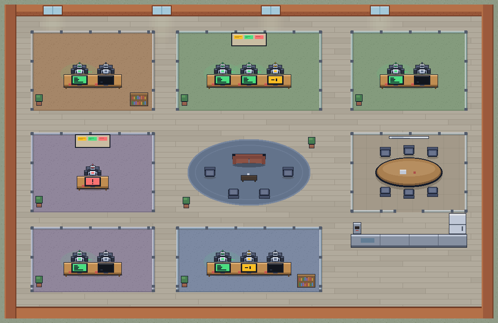

# airoom

**A control room for your Claude Code agents.**

You run Claude Code in five terminals. One is waiting for a yes, one hit a hook
error twenty minutes ago, three are fine, and the one that needs you is the one
you are not looking at. airoom puts all of them on one screen: every project is
a room, every session is a desk, and the monitor on the desk says who is
working, who is waiting on you and who is stuck. Click a desk to read what that
agent is doing and answer it without leaving the app.

<p align="center">
  
</p>

Everything stays on your machine. airoom reads the transcripts Claude Code
already writes to `~/.claude/projects`, drives agents through the Claude Agent
SDK with your own login, and binds to 127.0.0.1 only. It sends no telemetry.
Apart from Claude's own traffic to Anthropic, its only outbound request is a
version check against `airoom.dev/release.json`.

## Get it

| | |
| --- | --- |
| macOS on Apple Silicon | [airoom.dev/download](https://airoom.dev/download), signed and notarised |
| Windows 11 x64, beta | [airoom.dev/download?os=windows](https://airoom.dev/download?os=windows), not yet code-signed, so SmartScreen warns once per build |
| From source | [below](#run-from-source) |

Every installer is also on the [Releases page](https://github.com/petritavd/airoom/releases).

airoom needs [Claude Code](https://claude.com/claude-code) installed and logged
in. It drives the `claude` on your machine, on your account and your limits.

## What it does

- **One office for every project.** Each project with Claude Code sessions is a
  room; each session is a desk. Green monitor: working. Amber: finished a turn
  and waiting on you. Red: blocked by a hook or a refused permission. Dark:
  idle. The queue in the dock lists what needs you; ⌘K (Ctrl+K on Windows)
  jumps to any room, desk or action.
- **Chat with any agent where it sits.** Click a desk for its live activity
  feed and a composer. A message resumes that exact session in its project
  directory. Interrupt a run with one click.
- **Approvals, one tool call at a time.** Without the bypass toggle every tool
  call pauses with the exact command and Allow / Deny buttons; undecided
  requests deny themselves after ten minutes. Bypass is per run, for
  repositories you trust the agent in.
- **Hire.** An empty desk in any room starts a brand-new session with your
  first message. Hire a whole team with three questions (the goal, where they
  work, when they check in): a lead and a crew that work tasks in parallel,
  each in its own git worktree, with an optional token saver. Teams are parked,
  not killed, when you quit.
- **Knows when to interrupt you.** The menu-bar or tray badge says how many
  agents need you, and native notifications open the right desk. An agent
  waiting for you stays at its desk with a marker, so a glance is enough.
- **Yours to arrange.** Recolour rooms, choose which projects become rooms, add
  decor. Preferences live in `~/.airoom/`.

## Run from source

Node 20 or newer (CI uses 22), and Claude Code logged in.

```bash
npm run install:all      # server, web and desktop dependencies
npm run dev              # server on :8787 and the Vite UI on :5173
npm run app              # the desktop shell against a fresh web build
```

`npm run dist:unsigned` packages a macOS app for your own machine. The signed
release path is in [PACKAGING.md](PACKAGING.md), the Windows build in
[WINDOWS.md](WINDOWS.md) and the route to a signed Windows installer in
[WINDOWS-SIGNING.md](WINDOWS-SIGNING.md).

## How it works

```
┌──────────────┐   DataSource     ┌──────────────┐   WS / JSON   ┌──────────────┐
│ ~/.claude/   │  (interface)     │  server       │   protocol   │  web          │
│  projects/   │◀──LocalClaude────│  parse→model  │◀────────────▶│  pixel office │
└──────────────┘   DataSource     │  broadcast    │              │  (canvas)     │
                                  └──────────────┘              └──────────────┘
```

The server tails each session's JSONL transcript and flattens it into the model
in `shared/types.ts`, which is also the WebSocket protocol the web client
speaks. Two seams keep the local-only design swappable: `DataSource` (read:
where sessions come from) and `AgentController` (write: how an agent is
driven). Both have local implementations today; a hub for several machines
would be remote implementations of the same two interfaces, with the protocol
and the client unchanged.

## Messaging (the write path)

The engine is the Claude Agent SDK, driven in streaming-input mode from the
server (`server/src/agent/SdkClaudeController.ts`). Every send resumes the
clicked desk's session in its room's working directory, which is what gives
airoom interrupts, per-tool approvals and message-level streaming without
process cold starts. The SDK still writes the transcript to
`~/.claude/projects`, so the file watcher animates the desk exactly as it does
for a session started in a terminal. `AIROOM_ENGINE=cli` falls back to spawning
the CLI per message, with no interrupts and no interactive approvals.

Things worth knowing:

- `--resume <id>` keeps the session id and appends to the same transcript, so a
  desk's identity is stable across airoom messages.
- `/compact` can rewrite a session file in place; the parser keys its cache on
  size and mtime and never assumes append-only.
- Subagent transcripts live in `<project>/<sessionId>/subagents/` and are not
  desks.
- A desk is an active session from the last seven days; the most recent session
  of each project is always kept, so every project keeps its room. Claude Code
  itself deletes transcripts after about thirty days.
- **Don't double-drive a session:** avoid messaging a session that is also open
  in an interactive `claude` elsewhere; two processes on one session conflict.

## Playbooks (a task that worked once, written down)

Finish a job with an agent the way you want it, then open its desk and pick
**Make this a playbook** from the ⋯ menu. airoom reads the session — your
brief, every correction, what ran, what was checked — and proposes a card:
goal, inputs that change each run, standing rules, steps (with review points
where you wanted to look first), checks, and what to deliver. You edit it and
save; nothing is saved behind your back.

Two things make the second run cheaper than the first:

- **The approvals travel with it.** What you allowed in the original session
  becomes the run's allowlist, as Claude Code permission rules
  (`Bash(npm test:*)`, `Edit`, …), derived conservatively: a runner and its
  verb, exact commands for the risky ones, nothing for `rm`/`sudo`/force
  pushes. A run never raises a card for those; everything else still asks.
- **Corrections are either for this run or for good.** The composer of a
  playbook run has a "this run | remember" toggle. Remembered messages become
  visible rules on the card, tagged with the run they came from.

Every run keeps score — messages you had to send, approval cards raised —
against the original session's numbers, and the panel shows "first time →
last run". A run ends when the agent finishes with the line
`PLAYBOOK COMPLETE`; otherwise it is waiting on you. Playbooks live in
`~/.airoom/playbooks.json`; runs are ordinary sessions (a lavender card on the
desk marks them). `server/src/playbook/` holds the rules, the extraction and
the controller; `scripts/playbook-test.ts` proves them without a model.

## Connections (the sockets on the wall)

Every airoom run already gets the user's, the project's and the local MCP
servers, plus claude.ai connectors — the SDK loads all setting sources. The
office now shows them. Each room has a patch panel at the top-right of its
zone: one socket per connector its agents can reach, with a status LED in the
robots' palette (green connected, amber needs sign-in, red down, dark off).
When an agent calls a connector tool a pulse runs along a cable from its desk
to the socket. Hover for a summary; click (or use the room's ⚙ → Connections)
for the sheet: connectors grouped by scope, their tools with read-only and
destructive badges, the fix for anything unhealthy, a per-room on/off switch
for the project's own connectors, and a form to add one to `.mcp.json`.

Nothing goes on a wall without being asked. A project connector is on when
Claude Code has it enabled for the project. A shared one — user-wide or
claude.ai — is off every wall until you turn it on for a room, in the room's
settings (one switch per connector). Turning it on also makes sure Claude Code
loads it there; the sheet has a separate "disable for this project" for the
runtime side, which writes the same per-project list `/mcp` uses. The room's
choices live in `~/.airoom/connectors.json`; everything Claude Code reads
(`~/.claude.json` project lists, the project's `.mcp.json`) is written where
it keeps its own, so the terminal sees exactly what the office does. Status comes from the runtime (`mcpServerStatus`)
— a control-only query per room, cached, refreshed for free by any live run.
Sign-in for a connector that needs it happens in Claude Code (`/mcp`).
`server/src/connectors.ts` holds it all; `scripts/connectors-test.ts` proves it.

## How status is derived

Status heuristics live in `server/src/parse/sessionParser.ts`, pure and tested:

| Monitor | Meaning |
|---------|---------|
| 🟢 green | working: running a tool or mid-turn |
| 🟡 amber | waiting on you: finished a turn, your move |
| ⚪ dark | idle: no recent activity |
| 🔴 red | blocked: a hook error or a prevented continuation |

A "working" session that has stopped emitting for a while decays to idle; a
very old "your move" also decays to idle.

## Layout

```
shared/types.ts                      domain model + WS protocol (the contract)
shared/describeTool.ts               one line per tool call, for the feed
server/src/index.ts                  http + WebSocket gateway, approvals
server/src/datasource/               DataSource (read seam); LocalClaudeDataSource watches ~/.claude/projects
server/src/parse/sessionParser.ts    JSONL → session model
server/src/agent/                    AgentController (write seam); SdkClaudeController (Agent SDK),
                                     LocalClaudeController (CLI fallback), claudeBin (finding claude)
server/src/team/                     TeamController + worktrees: a lead, a crew, one lane each
server/src/release.ts                the version check
server/scripts/                      the test suite: plain tsx scripts, no framework
web/src/net/useFleet.ts              WS client, reconnect, live snapshot + runs
web/src/render/                      draw.ts (rooms, desks, monitors, name tags), sim.ts (who sits,
                                     who walks), PixelWorld.tsx (canvas, pan/zoom, hit testing)
web/src/ui/                          AgentPanel (feed + composer), TeamPanel, HireTeam, Queue,
                                     Palette (⌘K), RoomSettings, UpdateBar, …
web/src/shell.css                    the control-room chrome
desktop/main.js                      Electron shell: runs the server, window, tray badge,
                                     notifications, graceful quit
landing/                             airoom.dev: a dependency-free static server
design/                              pixel-art tooling and scene previews
scripts/scene.mjs                    stages rooms and agents on a running app, for screenshots
```

## Licence

airoom is free and open source under the [Apache License 2.0](LICENSE): use
it, change it, ship it, at home or at work, with no account and no key. If it
earns a place on your machine, [sponsor it](https://github.com/sponsors/petritavd).
A hosted office for teams is on the roadmap, and that one will be paid.

## Contributing

[CONTRIBUTING.md](CONTRIBUTING.md) has the setup and the gates. Short version:
`npx tsc --noEmit` in `server/` and `web/`, `npm test` in `server/`, and the
Windows workflow stays green. Security reports go to the address in
[SECURITY.md](SECURITY.md), not to the issue tracker.

## Roadmap

- Code-signed Windows builds ([WINDOWS-SIGNING.md](WINDOWS-SIGNING.md) has
  the route).
- A hosted office for a team, the paid product: the same client against
  remote `DataSource` and `AgentController` implementations.
- Sprites and sound.
