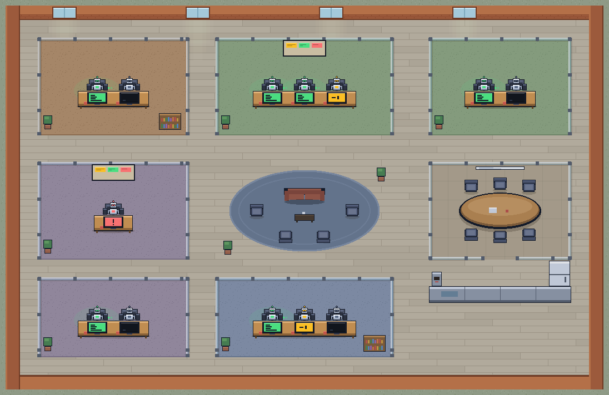

# airoom

**A control room for your Claude Code agents.**

You run Claude Code in five terminals. One is waiting for a yes, one hit a hook
error twenty minutes ago, three are fine, and the one that needs you is the one
you are not looking at. airoom puts all of them on one screen: every project is
a room, every session is a desk, and the monitor on the desk says who is
working, who is waiting on you and who is stuck. Click a desk to read what that
agent is doing and answer it without leaving the app.

<p align="center">
  
</p>

Everything stays on your machine. airoom reads the transcripts Claude Code
already writes to `~/.claude/projects`, drives agents through the Claude Agent
SDK with your own login, and binds to 127.0.0.1 only. It sends no telemetry.
Apart from Claude's own traffic to Anthropic, and the pages you or your agents
open in the browser pane, its only outbound request is a version check against
`airoom.dev/release.json`. The one exception is opt-in: a room that already
has a Cognivio connector can [share playbooks with a team](#sharing-a-playbook-with-your-team)
through it.

## Get it

| | |
| --- | --- |
| macOS on Apple Silicon | [airoom.dev/download](https://airoom.dev/download), signed and notarised |
| Windows 11 x64, beta | [airoom.dev/download?os=windows](https://airoom.dev/download?os=windows), not yet code-signed, so SmartScreen warns once per build |
| From source | [below](#run-from-source) |

Every installer is also on the [Releases page](https://github.com/petritavd/airoom/releases).

airoom needs [Claude Code](https://claude.com/claude-code) installed and logged
in. It drives the `claude` on your machine, on your account and your limits.

## What it does

- **One office for every project.** Each project with Claude Code sessions is a
  room; each session is a desk. Green monitor: working. Amber: finished a turn
  and waiting on you. Red: blocked by a hook or a refused permission. Dark:
  idle. The queue in the dock lists what needs you; ⌘K (Ctrl+K on Windows)
  jumps to any room, desk or action.
- **Chat with any agent where it sits.** Click a desk for its live activity
  feed and a composer. A message resumes that exact session in its project
  directory. Interrupt a run with one click.
- **Approvals, one tool call at a time.** Without the bypass toggle every tool
  call pauses with the exact command and Allow / Deny buttons; undecided
  requests deny themselves after ten minutes. Bypass is per run, for
  repositories you trust the agent in.
- **A browser in the office.** The desktop app has a browser pane where the
  office usually is, laid out like Chrome, with tabs. Open the app you are
  building and try it there, or ask an agent to: it opens the page in a tab
  of its own, clicks, types and reads the result while you watch, with its
  chat beside it. Profiles work as they do in Chrome, so the same page can be
  seen as an admin, as a customer or signed out. Or switch agents to your own
  Chrome, with your real profiles and sign-ins. Pages on your machine open
  freely; any other site asks you first.
- **Hire.** An empty desk in any room starts a brand-new session with your
  first message. Hire a whole team with three questions (the goal, where they
  work, when they check in): a lead and a crew that work tasks in parallel,
  each in its own git worktree, with an optional token saver. Teams are parked,
  not killed, when you quit.
- **Knows when to interrupt you.** The menu-bar or tray badge says how many
  agents need you, and native notifications open the right desk. An agent
  waiting for you stays at its desk with a marker, so a glance is enough.
- **Yours to arrange.** Recolour rooms, choose which projects become rooms, add
  decor. Preferences live in `~/.airoom/`.

## Run from source

Node 20 or newer (CI uses 22), and Claude Code logged in.

```bash
npm run install:all      # server, web and desktop dependencies
npm run dev              # server on :8787 and the Vite UI on :5173
npm run app              # the desktop shell against a fresh web build
```

`npm run dist:unsigned` packages a macOS app for your own machine. The signed
release path is in [PACKAGING.md](PACKAGING.md), and the Windows build is
described in [WINDOWS.md](WINDOWS.md).

## How it works

```
┌──────────────┐   DataSource     ┌──────────────┐   WS / JSON   ┌──────────────┐
│ ~/.claude/   │  (interface)     │  server       │   protocol   │  web          │
│  projects/   │◀──LocalClaude────│  parse→model  │◀────────────▶│  pixel office │
└──────────────┘   DataSource     │  broadcast    │              │  (canvas)     │
                                  └──────────────┘              └──────────────┘
```

The server tails each session's JSONL transcript and flattens it into the model
in `shared/types.ts`, which is also the WebSocket protocol the web client
speaks. Two seams keep the local-only design swappable: `DataSource` (read:
where sessions come from) and `AgentController` (write: how an agent is
driven). Both have local implementations today; a hub for several machines
would be remote implementations of the same two interfaces, with the protocol
and the client unchanged.

## Messaging (the write path)

The engine is the Claude Agent SDK, driven in streaming-input mode from the
server (`server/src/agent/SdkClaudeController.ts`). Every send resumes the
clicked desk's session in its room's working directory, which is what gives
airoom interrupts, per-tool approvals and message-level streaming without
process cold starts. The SDK still writes the transcript to
`~/.claude/projects`, so the file watcher animates the desk exactly as it does
for a session started in a terminal.

Things worth knowing:

- `--resume <id>` keeps the session id and appends to the same transcript, so a
  desk's identity is stable across airoom messages.
- `/compact` can rewrite a session file in place, so a file is only read from
  where reading stopped when it provably just grew; otherwise it is read again
  from the top.
- Transcripts get large: every screenshot an agent reads is in there as
  base64, and a long session passes a hundred megabytes while it is still
  being written. They are never held whole in memory. Files are streamed a
  line at a time, and a session still being written keeps its parse open, so
  only the bytes it appended are read. "It only grew" is checked each time
  (same file, same first bytes, same bytes before where reading stopped). A
  desk keeps only its last few steps; the chat panel keeps a session's whole
  history, for the three sessions opened last.
  `scripts/transcript-scale-test.ts` proves it, including a 96 MB transcript
  read inside a 96 MB heap.
- Subagent transcripts live in `<project>/<sessionId>/subagents/` and are not
  desks.
- A desk is an active session from the last seven days; the most recent session
  of each project is always kept, so every project keeps its room. Claude Code
  itself deletes transcripts after about thirty days.
- **Don't double-drive a session:** avoid messaging a session that is also open
  in an interactive `claude` elsewhere; two processes on one session conflict.

## Playbooks (a task that worked once, written down)

Finish a job with an agent the way you want it, then open its desk and pick
**Make this a playbook** from the ⋯ menu. airoom reads the session — your
brief, every correction, what ran, what was checked — and proposes a card:
goal, inputs that change each run, standing rules, steps (with review points
where you wanted to look first), checks, and what to deliver. You edit it and
save; nothing is saved behind your back.

Two things make the second run cheaper than the first:

- **The approvals travel with it.** What you allowed in the original session
  becomes the run's allowlist, as Claude Code permission rules
  (`Bash(npm test:*)`, `Edit`, …), derived conservatively: a runner and its
  verb, exact commands for the risky ones, nothing for `rm`/`sudo`/force
  pushes. A run never raises a card for those; everything else still asks.
- **Corrections are either for this run or for good.** The composer of a
  playbook run has a "this run | remember" toggle. Remembered messages become
  visible rules on the card, tagged with the run they came from.

Every run keeps score — messages you had to send, approval cards raised —
against the original session's numbers, and the panel shows "first time →
last run". A run ends when the agent finishes with the line
`PLAYBOOK COMPLETE`; otherwise it is waiting on you. Playbooks live in
`~/.airoom/playbooks.json`; runs are ordinary sessions (a lavender card on the
desk marks them). `server/src/playbook/` holds the rules, the extraction and
the controller; `scripts/playbook-test.ts` proves them without a model.

### Sharing a playbook with your team

A playbook is a file on one machine. If a room has a
[Cognivio](https://github.com/Elbani/cognivio) connector (a team knowledge
base agents read over MCP, hosted or self-hosted), its cards get a **share**
button. Share copies the card to the team as a document, and the Playbooks
list on a teammate's machine shows it under **From your team** for the same
project. **Get** opens it in the editor as a proposal; it is theirs once they
save it.

- **No settings.** The address and the key are the ones in the room's own
  Cognivio connector (`.mcp.json` or `~/.claude.json`), so airoom talks only
  to a server that room's agents already talk to. A room without the
  connector shows no button and makes no request.
- **When it calls.** Opening the Playbooks list asks what the team has;
  share and Get call on the click. Nothing runs in the background.
- **Only the card travels:** name, goal, inputs, rules, steps, checks, what
  to deliver, the allowlist, and what the first session cost. Runs, session
  ids, transcripts, the permission mode and the model stay behind.
- **A teammate's card is untrusted.** Its allowlist passes the same check as
  an edited card (nothing for `rm`, `sudo` or a bare `Bash`), and the editor
  shows every rule and every allowed call before anything is saved.
- **One copy per name.** Sharing again after an edit updates the shared
  document. A saved card does not follow later changes; a card whose name
  you already have in that room is not offered again.

A project is matched by its folder name, which is the same on every machine
that cloned it. A key that reaches several Cognivio teams shares to the one
named after the project. `server/src/playbook/share.ts` holds it all;
`scripts/playbook-share-test.ts` proves it against a stand-in server on
127.0.0.1.

## Connections (the sockets on the wall)

Every airoom run already gets the user's, the project's and the local MCP
servers, plus claude.ai connectors — the SDK loads all setting sources. The
office now shows them. Each room has a patch panel at the top-right of its
zone: one socket per connector its agents can reach, with a status LED in the
robots' palette (green connected, amber needs sign-in, red down, dark off).
When an agent calls a connector tool a pulse runs along a cable from its desk
to the socket. Hover for a summary; click (or use the room's ⚙ → Connections)
for the sheet: connectors grouped by scope, their tools with read-only and
destructive badges, the fix for anything unhealthy, a per-room on/off switch
for the project's own connectors, and a form to add one to `.mcp.json`.

Nothing goes on a wall without being asked. A project connector is on when
Claude Code has it enabled for the project. A shared one — user-wide or
claude.ai — is off every wall until you turn it on for a room, in the room's
settings (one switch per connector). Turning it on also makes sure Claude Code
loads it there; the sheet has a separate "disable for this project" for the
runtime side, which writes the same per-project list `/mcp` uses. The room's
choices live in `~/.airoom/connectors.json`; everything Claude Code reads
(`~/.claude.json` project lists, the project's `.mcp.json`) is written where
it keeps its own, so the terminal sees exactly what the office does. Status comes from the runtime (`mcpServerStatus`)
— a control-only query per room, cached, refreshed for free by any live run.
Sign-in for a connector that needs it happens in Claude Code (`/mcp`).
`server/src/connectors.ts` holds it all; `scripts/connectors-test.ts` proves it.

## The browser pane (a page your agents can drive)

The desktop app's rail has a globe. It puts a real browser on the stage, in
place of the office, with the agent's chat still docked beside it. It is laid
out the way Chrome is: tabs with the page's icon and title and a new-tab
button, back, forward and reload, the address bar, and a profile button at
the right. Each tab is a `<webview>` with storage of its own, so what you sign
in to there stays there, and nothing in it can reach airoom's own window.
Chrome's keys work, from airoom or from inside a page: ⌘T, ⌘W, ⌘L, ⌘R,
Ctrl+Tab, ⌘1 to ⌘9 (Ctrl in place of ⌘ on Windows). With the browser on the
stage, ⌘W closes a tab and ⌘R reloads the page, not airoom's window. A link
that opens a new window opens a new tab beside its own. A tab that is not
showing keeps running, and up to sixteen can be open.

Profiles are Chrome's idea of them. Each has its own cookies, storage and
sign-ins; the button at the right of the toolbar switches, adds, renames and
removes them. Switching keeps the address and opens it as the other profile,
which is the point: the same page as an admin, as a customer, signed out.
Guest is kept in memory only and is emptied when you leave it. These are
airoom's profiles, not the ones in your Chrome: another browser's profile
cannot be opened from here. An agent works in whichever profile is showing and
is told its name, and a site cleared for an agent in one profile is not
cleared in another.

Every Claude run started from airoom carries twelve tools for that pane, as an
in-process MCP server named `airoom-browser`: `navigate`, `snapshot`, `click`,
`type`, `select`, `press`, `scroll`, `wait`, `screenshot`, `console`, `tabs`
and `evaluate`. An agent works in a tab of its own: the first page it opens
gets a new tab beside the one showing, unless that one is a blank New Tab, so
a page you have open is never replaced. A link it clicks that opens a new
window takes it into the new tab. `tabs` lists, opens and switches tabs, and
closes the ones the agent opened (never one you had open). The tools are
always loaded, never deferred behind tool search: a model that has to go
looking for the tool that picks a dropdown option spends more than the tools
cost. An agent reads a page as an outline of what is visible, with a ref on
every element it can act on, and acts by ref.

An agent acts on the page from inside it. A click is the events a click fires,
in order, at the element's own position; text goes in through the browser's
editing commands; a key press reaches the page's handlers and then does what
the browser would have done with it. Nothing is sent through the window's
mouse or keyboard, because a mouse press delivered that way moves the window's
keyboard focus into the page, and whoever was typing a message to an agent
would be typing into the app under test. It also means a test keeps running
while the office is showing or the window is in the background. The price is
fidelity at the edges: the events are not marked as trusted, CSS `:hover` does
not apply, and a native dropdown is chosen from with `select`, not opened. No
debugging port is opened.

The pane lives in the shell, a separate process from the server. The shell
already holds a socket to the server, so a tool call goes down that socket as
a `browserCmd` and its answer comes back as a `browserResult`. Nothing new
listens on the machine.

- **What asks first.** Pages on this machine (`localhost`, `127.0.0.1`,
  `*.localhost`) never raise a card. The first call that would read or act on
  any other site goes through the ordinary approval, and one yes covers that
  site for the rest of the run. Until then a page on such a site gives the
  agent its address and nothing else. Bypass mode skips the card, as it does
  for every tool.
- **A tab each.** Agents work side by side, each in a tab of its own. A tab
  stays with the agent working in it until that agent has been quiet for
  twenty seconds; another agent that finds it showing is told to open a tab of
  its own. What an agent may do is judged by the page in its own tab, not by
  the one showing.
- **Who is driving.** The toolbar names the agent while it acts, and its tab
  carries a dot. The pane comes to the stage, and the agent's tab to the
  front, by itself only when you are already at that agent's desk; otherwise
  the rail lights up and the office stays where it is.

**Use my Chrome.** The ⋮ menu (or ⌘K, "Agents use my Chrome") switches agents
from these tabs to your own Chrome, with its real profiles and everything you
are signed in to there. airoom does not open Chrome's data itself; it turns
on Claude Code's own integration, Claude in Chrome (`--chrome`), for every run
it starts. That needs the Claude in Chrome extension installed and signed in
to the same Claude account, and Chrome open. The integration refuses
long-lived tokens, so those runs use Claude Code's own sign-in (`/login`), not
the token pasted into airoom; switching checks both, without spending tokens,
and says what is missing. The policy is the same as in airoom's tabs: pages on
this machine go through without a card, and the first step on any other site
asks, with "always allow" clearing that site for the session. Running
JavaScript in a page or uploading a file always asks. If several Chrome
browsers are connected, the first agent asks which one, and Claude Code
remembers the answer. The switch applies from the next message; it lives in
`~/.airoom/browser.json`.

`AIROOM_BROWSER=0` leaves the browser out of every run, airoom's tabs and
Chrome alike. `desktop/browser.js` carries the commands out and keeps the
tabs and profiles; `server/src/browser/` holds the relay, the policy, the
tools and the Chrome switch; `scripts/browser-test.ts` proves the server
half, `scripts/browser-shell-test.ts` the profiles and keys, and
`scripts/browser-harness.ts` stands in for the server so the pane can be
exercised against a real shell with no agent and no tokens.

## How status is derived

Status heuristics live in `server/src/parse/sessionParser.ts`, pure and tested:

| Monitor | Meaning |
|---------|---------|
| 🟢 green | working: running a tool or mid-turn |
| 🟡 amber | waiting on you: finished a turn, your move |
| ⚪ dark | idle: no recent activity |
| 🔴 red | blocked: a hook error or a prevented continuation |

A "working" session that has stopped emitting for a while decays to idle; a
very old "your move" also decays to idle.

## Layout

```
shared/types.ts                      domain model + WS protocol (the contract)
shared/describeTool.ts               one line per tool call, for the feed
shared/browserUrl.ts                 what an address is, and which addresses are this machine
server/src/index.ts                  http + WebSocket gateway, approvals
server/src/datasource/               DataSource (read seam); LocalClaudeDataSource watches ~/.claude/projects
server/src/parse/sessionParser.ts    JSONL → session model, one record at a time
server/src/agent/                    AgentController (write seam); SdkClaudeController (Agent SDK),
                                     claudeBin (finding claude)
server/src/playbook/                 playbooks: rules, extraction, the controller, sharing with a team
server/src/team/                     TeamController + worktrees: a lead, a crew, one lane each
server/src/browser/                  the browser pane's server half: relay to the shell, site policy, tools
server/src/release.ts                the version check
server/scripts/                      the test suite: plain tsx scripts, no framework
web/src/net/useFleet.ts              WS client, reconnect, live snapshot + runs
web/src/render/                      draw.ts (rooms, desks, monitors, name tags), sim.ts (who sits,
                                     who walks), PixelWorld.tsx (canvas, pan/zoom, hit testing)
web/src/ui/                          AgentPanel (feed + composer), TeamPanel, HireTeam, Queue,
                                     Palette (⌘K), RoomSettings, UpdateBar, BrowserPane, …
web/src/shell.css                    the control-room chrome
desktop/main.js                      Electron shell: runs the server, window, tray badge,
                                     notifications, graceful quit
desktop/browser.js                   the browser pane: a <webview> per tab, its profiles, and what
                                     agents ask of it over the shell's own socket
landing/                             airoom.dev: a dependency-free static server
design/                              pixel-art tooling and scene previews
scripts/scene.mjs                    stages rooms and agents on a running app, for screenshots
```

## Licence

airoom is free and open source under the [Apache License 2.0](LICENSE): use
it, change it, ship it, at home or at work, with no account and no key. If it
earns a place on your machine, [sponsor it](https://github.com/sponsors/petritavd).
A hosted office for teams is on the roadmap, and that one will be paid.

## Contributing

[CONTRIBUTING.md](CONTRIBUTING.md) has the setup and the gates. Short version:
`npx tsc --noEmit` in `server/` and `web/`, `npm test` in `server/`, and the
Windows workflow stays green. Security reports go to the address in
[SECURITY.md](SECURITY.md), not to the issue tracker.

## Roadmap

- Code-signed Windows builds.
- A hosted office for a team, the paid product: the same client against
  remote `DataSource` and `AgentController` implementations.
- Sprites and sound.
